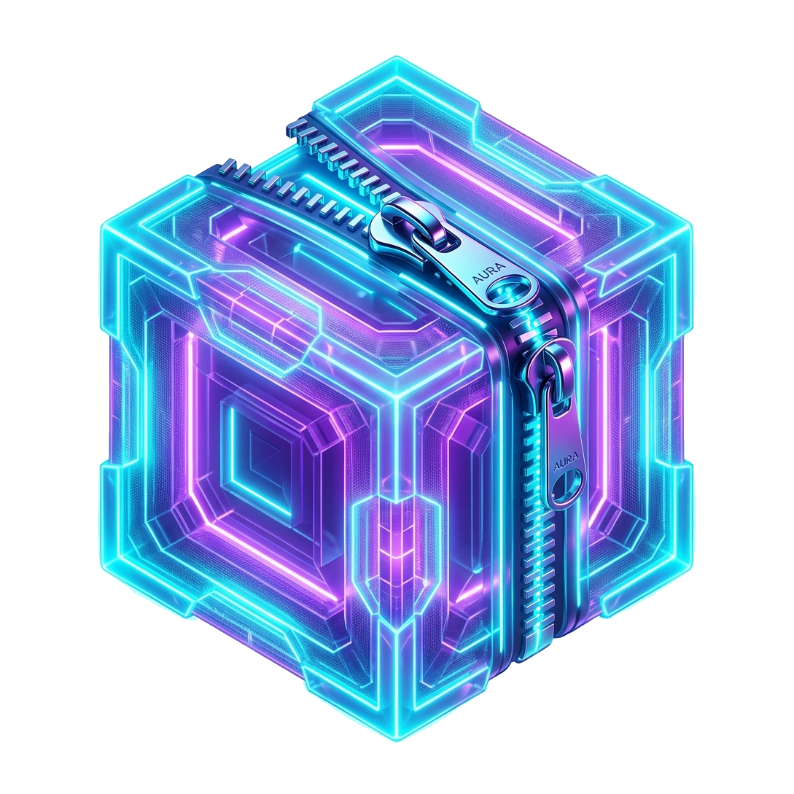

# AuraZip (아우라집)

<div align="center">



### 차세대 고성능 통합 압축 & 보안 아카이브 유틸리티
**Next-Generation High-Performance Archive & Security Manager**

[](https://github.com/cybereun/AuraZip/releases)
[](https://github.com/cybereun/AuraZip/actions)


[-7928CA?logo=github)](https://github.com/cybereun)
[](LICENSE)

</div>

---

## 📌 개요 (Overview)

**AuraZip**은 현대적인 오피스 스타일의 **리본 메뉴(Ribbon Menu) 인터페이스**, 고효율 **멀티포맷 압축 엔진**, 군사 표준 **AES-256 암호화**, 그리고 **실시간 자동 업데이트(OTA)** 시스템을 결합한 올인원 Windows 데스크톱 압축 관리 유틸리티입니다.

---

## 🚀 최신 릴리즈 다운로드 (v1.0.4)

공식 릴리즈 페이지: [https://github.com/cybereun/AuraZip/releases/tag/v1.0.4](https://github.com/cybereun/AuraZip/releases/tag/v1.0.4)

| 패키지 형태 | 파일명 | 용량 | 특징 및 권장 사용자 | 다운로드 |
|---|---|---|---|:---:|
| **표준 설치 프로그램** | `AuraZip_Setup_v1.0.4.exe` | ~37.3 MB | • Windows 설치 마법사<br>• 바탕화면/시작메뉴 전용 아이콘 자동 등록<br>• **ZIP/7Z 기본 연결(더블 클릭 시 자동 실행 및 전용 아이콘 표시)**<br>• 원클릭 OTA 자동 업데이트 지원 | [다운로드](https://github.com/cybereun/AuraZip/releases/download/v1.0.4/AuraZip_Setup_v1.0.4.exe) |
| **무설치 포터블** | `AuraZip_Portable_v1.0.4.zip` | ~51.6 MB | • 설치 과정 및 관리자 권한 불필요<br>• USB 또는 원하는 폴더에 압축 풀고 즉시 실행 | [다운로드](https://github.com/cybereun/AuraZip/releases/download/v1.0.4/AuraZip_Portable_v1.0.4.zip) |

---

## ✨ 핵심 기능 및 개선 사항 (Features)

### 1. 🎨 투명 배경 고해상도 앱 아이콘 & Windows 통합
- 외곽 테두리 없는 **투명 배경의 사이언/네온 퍼플 아우라 큐브 & 지퍼 디자인** 탑재
- Windows 전용 `AppUserModelID`(`AuraStudios.AuraZip.App.1.0.0`) 등록을 통해 작업 표시줄에서 전용 고화질 아이콘으로 독립 표시
- 메인 윈도우 타이틀바, 시작 화면 대시보드(72px 로고), About 정보 대화상자에 통일된 아이콘 브랜딩 적용

### 2. 🗂️ 기본 압축 프로그램 자동 연결 (File Association)
- 설치 마법사에서 **`ZIP 파일(.zip) 기본 연결`** 및 **`7Z 파일(.7z) 기본 연결`**이 기본 체크되어 제공
- 설치 완료 후 탐색기에서 `.zip` 파일을 더블 클릭하면 AuraZip이 즉시 실행되며 아카이브 내용 자동 로드
- Windows 10/11 공식 규격인 `Capabilities` 및 `RegisteredApplications` 레지스트리 완벽 등록
- 앱 내부 리본 메뉴의 `[기본 앱 설정]` 버튼으로 언제든지 Windows 설정 창을 열어 기본 앱 관리 가능

### 3. 🔄 실시간 OTA 자동 업데이트 (Auto-Updater)
- **백그라운드 자동 검사**: 앱 시작 2.5초 후 GitHub Releases API를 조회하여 최신 버전 확인
- **수동 검사 지원**: `도움말 > 업데이트 확인` 버튼으로 실시간 버전 체크
- **모던 업데이트 알림창**: 새 버전 감지 시 변경 사항 요약(Release Notes) 팝업 제공
- **원클릭 자동 업데이트**: "지금 업데이트 및 재시작" 클릭 시 프로그레스 바와 함께 최신 패키지를 자동 다운로드하고, 기존 프로세스를 안전하게 종료한 뒤 설치 마법사 실행 및 재시작

### 4. 🎛️ 모던 리본 메뉴 (Ribbon Menu) 5대 탭 구성
- **📁 파일 / 홈 (File & Home)**: 새로 압축(`Ctrl+N`), 열기(`Ctrl+O`), 압축 풀기(`Ctrl+E`), 닫기(`F4`), 다른 이름으로 저장, 파일 위치 폴더 열기, 아카이브 삭제/영구삭제, 새 창 띄우기, 최근 파일 목록
- **✏️ 편집 (Edit)**: 파일 추가(`Ins`), 파일 삭제(`Del`), 이름 바꾸기(`F2`), 클립보드 복사/붙여넣기, 파일 경로 복사, 주석 편집(`Ctrl+Shift+M`), 모두 선택(`Ctrl+A`), 선택 반전
- **🛡️ 도구 & 보안 (Tools & Security)**: 무결성 검사(`Ctrl+T`), Windows Defender 악성코드 검사(`Ctrl+I`), 손상 아카이브 복구, 암호 복구 마법사, 실시간 검색(`Ctrl+F`), 기본 앱 설정
- **👁️ 보기 (View & Layout)**: 시작 화면(`F6`), 경로 내비게이션(`F7`), 상태 표시줄 토글, 파일 설명창(`F8`), 썸네일 미리보기, 항상 위에 표시, 테마/색상 변경(인디고, 다크, 에메랄드, 화이트)
- **❓ 도움말 (Help)**: 프로그램 정보(About), 설치 폴더 열기, 사용자 가이드, 업데이트 확인

---

## 🛠️ 설치 및 사용 방법 (Installation & Usage)

### 방법 A. 표준 설치 프로그램 사용 (권장)
1. [`AuraZip_Setup_v1.0.0.exe`](https://github.com/cybereun/AuraZip/releases/download/v1.0.0/AuraZip_Setup_v1.0.0.exe)를 다운로드합니다.
2. 설치 마법사를 실행합니다. (기본값으로 바탕화면 바로가기 및 `.zip`/`.7z` 파일 연결이 체크되어 있습니다.)
3. 설치 완료 후 바탕화면의 **AuraZip** 아이콘을 클릭하거나, 임의의 `.zip` 파일을 더블 클릭하여 바로 사용합니다.

### 방법 B. 무설치 포터블 버전 사용
1. [`AuraZip_Portable_v1.0.0.zip`](https://github.com/cybereun/AuraZip/releases/download/v1.0.0/AuraZip_Portable_v1.0.0.zip)을 다운로드합니다.
2. 원하는 위치(예: `C:\Tools\AuraZip` 또는 USB)에 압축을 풉니다.
3. 폴더 내 `AuraZip.exe`를 더블 클릭하여 바로 실행합니다.

### 방법 C. 소스코드에서 직접 실행 (개발자용)
```powershell
# 저장소 복제
git clone https://github.com/cybereun/AuraZip.git
cd AuraZip

# 의존 패키지 설치
pip install -r requirements.txt

# 앱 실행
python main.py
```

---

## 🔄 지속적 업데이트 & 배포 워크플로 (Release Workflow)

새로운 기능 추가나 버그 수정 후 버전을 올릴 때 아래 3단계만 진행하면 클라우드에서 자동으로 배포되고 사용자에게 업데이트가 전달됩니다:

1. **버전 번호 및 릴리즈 노트 갱신**:
   - [`version.py`](file:///y:/내%20드라이브/AI/App_Bulid/AuraZip/version.py)의 `APP_VERSION`을 수정합니다 (예: `APP_VERSION = "v1.0.1"`).
   - 본 `README.md`의 **업데이트 내역 (Changelog)** 섹션에 수정 요약 사항을 추가합니다.
2. **깃 커밋 및 태그 푸시**:
   ```bash
   git add .
   git commit -m "feat: release v1.0.1 - 주요 변경 내역 요약"
   git tag v1.0.1
   git push origin main
   git push origin v1.0.1
   ```
3. **자동 빌드 및 배포 완료**:
   - GitHub Actions([release.yml](.github/workflows/release.yml))가 클라우드에서 **설치형(`.exe`)과 포터블(`.zip`) 2종**을 자동 빌드하여 GitHub Release에 게시합니다.
   - 기존 AuraZip 사용자는 앱 실행 시 자동으로 새 버전을 인식하여 알림을 받고, 원클릭으로 다운로드 및 자동 재시작 업데이트를 수행합니다.

---

## 📋 업데이트 내역 (Changelog)

### [v1.0.4] - 2026-10-20
#### 🎨 테마 프리셋 엔진 전면 개편 & 콤보박스 체크표시 겹침 오류 완벽 해결
- **콤보박스 글자/체크마크 겹침 버그 근본 해결**: 테마 선택 대화상자에서 QComboBox 드롭다운 화살표(`down-arrow`)의 Qt 스타일시트 서브컨트롤 의사상태 문법 오류로 인해 텍스트 중앙에 겹쳐 보이던 보라색 체크표시 아이콘을 우측 드롭다운 영역으로 정확히 분리 및 고정
- **테마 프리셋 4종 전면 동적 연동**:
  - `Aura Indigo (기본 시그니처)`: 시그니처 인디고 & 클린 슬레이트 모던 룩
  - `Dark Slate (다크 슬레이트 모드)`: 눈이 편안한 딥 네이비/다크 슬레이트 톤의 올인원 다크 테마 (리본 바, 탭, 액션 카드, 테이블, 뷰어 완벽 다크화)
  - `Emerald Mint (에메랄드 민트)`: 상쾌하고 싱그러운 에메랄드 그린/민트 테마
  - `Sunset Coral (선셋 코랄 모드)`: 따뜻하고 세련된 오렌지/선셋 코랄 테마
- **리본/카드/테이블/뷰 전역 동적 테마 전파**: 인라인 하드코딩 스타일을 전면 제거하고 테마 변경 시 RibbonBar, ActionCard, StartView, ArchiveView, TableWidget, PreviewPanel, StatsBanner에 즉시 반영
- **테마 설정 영구 보존**: Windows Registry `QSettings` 연동으로 앱을 재시작해도 선택한 테마가 유지되도록 지원

### [v1.0.3] - 2026-10-20
#### 🛡️ Windows 기본 프로그램 아이콘 및 바로가기 속성 오류 완전 해결
- **탐색기 기본 앱 아이콘 깨짐 현상 해결**: Windows에서 `.zip` 및 `.7z` 파일의 기본 연결 프로그램을 AuraZip으로 설정 시 파일 탐색기에서 흰색 빈 문서로 깨져 나오던 현상을 완벽 수정
- **설치 패키지 내 아이콘 리소스 배치 정정**: PyInstaller onedir 빌드 특성상 `_internal` 하위에만 존재하던 `assets` 폴더를 `{app}\assets` 루트 경로에도 물리적으로 직접 배포하도록 인스톨러 및 빌드 스크립트 수정 (`app_icon.ico 파일을 찾을 수 없습니다` 오류 완전 해결)
- **Windows Registry DefaultIcon 규격 표준화**: 레지스트리 `DefaultIcon` 등록 시 `.ico` 단독 파일 경로 규격(`{app}\assets\app_icon.ico`)으로 등록하고, 인스톨러 완료 시 Windows 셸 아이콘 캐시 새로고침 API(`SHChangeNotify`)를 호출하여 재부팅 없이 즉시 선명한 아이콘이 반영되도록 개선
- **멀티 해상도(16~256px) ICO 완성**: Windows 탐색기 목록 보기, 자세히 보기, 큰 아이콘, 초고해상도 DPI 환경 등 모든 보기 모드에서 선명하게 렌더링되도록 7단계 멀티 레이어 아이콘 번들 탑재

### [v1.0.2] - 2026-10-20
#### 🎨 상단 탭 영역 색상 균일화 & 메인 아이콘 투명화 완성
- **상단 탭 바 우측 영역 배경 일치화**: 리본 탭 바 우측의 빈 공간을 인접한 탭 배경과 동일한 부드러운 슬레이트 톤(`#F1F5F9`)으로 통일하고, 탭 하단 전체를 가로지르는 1px 구분선(`border-top: 1px solid #CBD5E1`)을 연결하여 일체감 형성
- **메인 로고 아이콘 완전 투명화**: 시작 화면(StartView) 중앙 로고 아이콘 외곽의 흰색 사각형 여백을 정밀 제거하고 완전 투명 알파 채널 적용, 본문 캔버스 배경 위에서 이질감 없는 자연스러운 플로팅 룩 완성
- **아이콘 리소스 일괄 갱신**: `app_icon.png` 및 멀티 해상도(16~256px) `app_icon.ico`에 투명화 아이콘 일괄 반영

### [v1.0.1] - 2026-10-20
#### ✨ UI/UX 경계선 고도화 & OTA 자동 업데이트 릴리즈
- **리본-본문 경계 구분선 추가**: 상단 리본 메뉴 하단에 2px Slate(#94A3B8) 솔리드 구분선을 추가하여 시각적 분리선 형성
- **작업 캔버스 배경색 분리**: 본문 작업 영역(StartView/ArchiveView)에 부드러운 슬레이트 캔버스(#F1F5F9) 배경을 적용하여 상단 리본(#FFFFFF)과 대조 및 액션 카드 플로팅 효과 극대화
- **OTA 자동 업데이트 검증**: v1.0.0 버전 사용자가 앱 실행 시 또는 리본 [도움말] -> [업데이트 확인] 클릭 시 새 버전을 즉시 인식하고 원클릭 자동 다운로드 및 설치 재시작 지원

### [v1.0.0] - 2026-10-20
#### 🎉 첫 번째 공식 릴리즈 (Initial Official Release)
- **아이콘 시스템**: 투명 배경 대형 아우라 큐브/지퍼 아이콘 제작, Windows AppUserModelID 연동으로 작업 표시줄 및 바탕화면 분리 아이콘 등록
- **파일 연결 지원**: 설치 시 `.zip`, `.7z` 파일의 기본 연결 프로그램으로 자동 등록, 더블 클릭 시 탐색기에서 즉시 실행
- **배포 패키징**: 단일 설치 마법사(`AuraZip_Setup_v1.0.0.exe`) 및 무설치 포터블 패키지(`AuraZip_Portable_v1.0.0.zip`) 동시 릴리즈
- **OTA 자동 업데이트**: GitHub Releases API 연동 백그라운드 버전 감지, 릴리즈 노트 알림 대화상자, 원클릭 다운로드 및 자동 재시작 구현
- **리본 메뉴 고도화**: 5개 탭(파일, 편집, 도구&보안, 보기, 도움말)의 리본 UI 탑재 및 20개 단축키 지원
- **UI/UX 개선**: 상단 리본 메뉴와 하단 본문 영역 간 뚜렷한 경계선(2px Slate 구분선) 및 캔버스 배경색(#F1F5F9) 분리 적용으로 시각적 구분감 및 가독성 대폭 향상
- **코어 엔진 확장**: ZIP, 7Z, TAR, TGZ, TBZ2 멀티포맷 압축/해제 및 AES-256 군사 표준 암호화 지원
- **안전 & 복구**: CRC-32 무결성 검사, Windows Defender 실시간 악성코드 검사, 손상 아카이브 복구 마법사 탑재

---

## 👨‍💻 개발자 정보 (Developer Information)

- **제작자 / 개발자**: `@2026Lebi`
- **GitHub**: [@cybereun](https://github.com/cybereun)
- **저장소**: [https://github.com/cybereun/AuraZip](https://github.com/cybereun/AuraZip)
- **문의 & 이슈 보고**: [GitHub Issues](https://github.com/cybereun/AuraZip/issues)

---

## 📄 라이선스 (License)

Copyright © 2026 **@2026Lebi (cybereun)**. All rights reserved.  
본 프로젝트는 [MIT 라이선스](LICENSE)에 따라 자유롭게 사용 및 배포할 수 있습니다.
